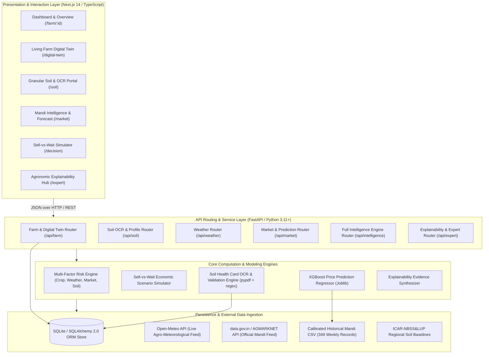
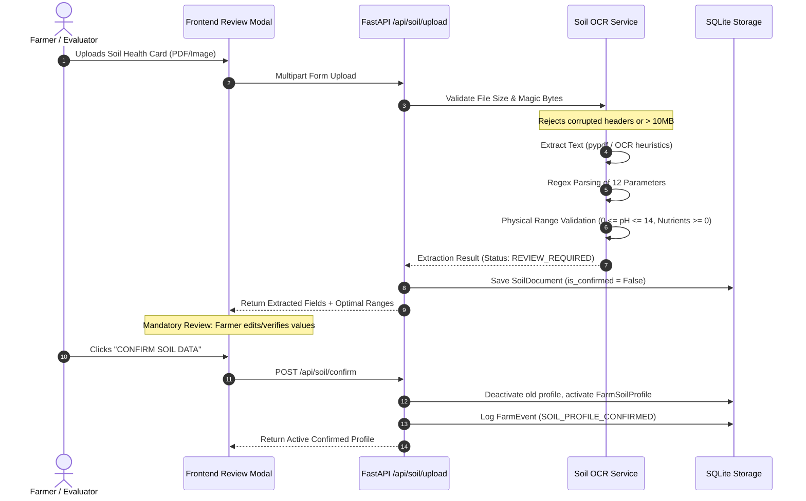
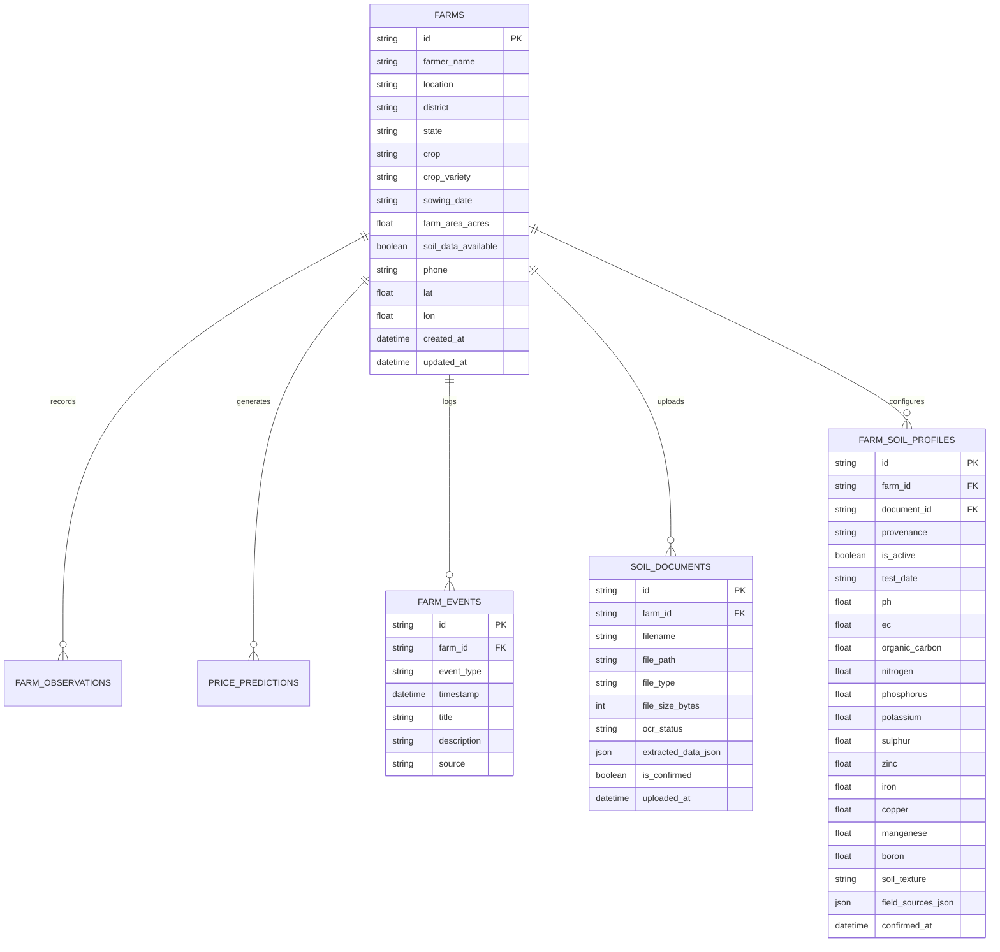
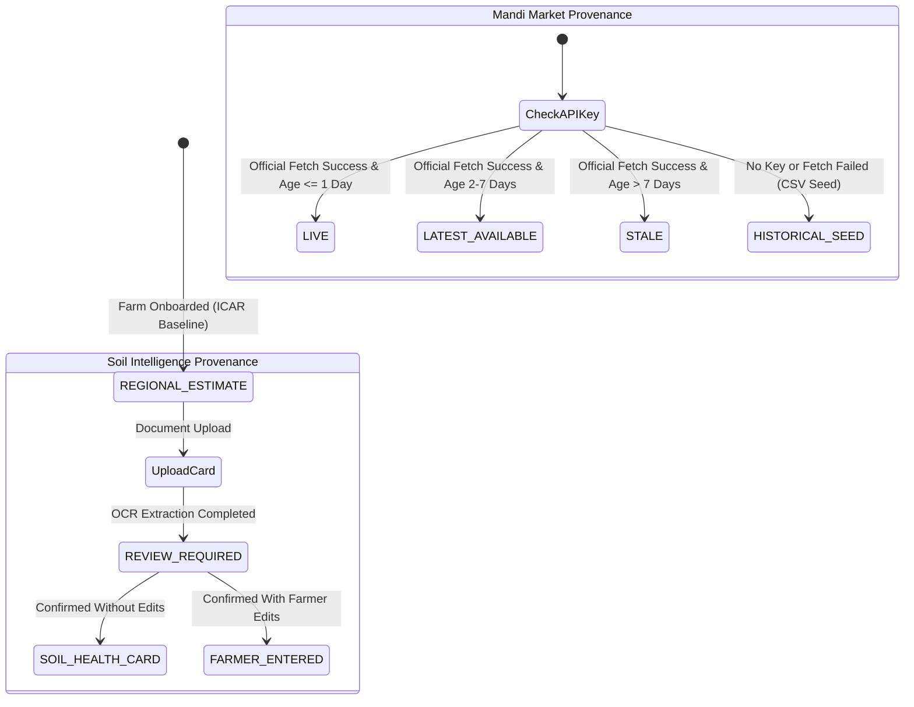

# KRISHI Intelligence: System Architecture & Technical Specifications

> **Academic Context**: 3rd-Year B.Tech Mini Project  
> **Discipline**: Computer Science & Engineering / Information Technology  
> **Domain**: Artificial Intelligence, Multi-Source Data Fusion, Agricultural Informatics  

---

## 1. System Overview & Architectural Philosophy

Modern agricultural systems frequently fail smallholder farmers not due to a shortage of raw data, but because of **fragmentation, uncalibrated estimates, and ungrounded advice**. Satellite feeds, regional weather forecasts, and mandi spot prices exist in disparate silos, forcing farmers to rely on guesswork during critical cultivation and marketing junctures.

**KRISHI Intelligence** is engineered as an **agentic, multi-source data fusion decision-support system** that synthesizes hyper-local farm telemetry into a living **Farm Digital Twin**. The system architecture adheres to four core engineering tenets:

1. **Strict Data Groundedness & Zero Fabrication**: The system never generates ungrounded advice. When external APIs fail or are unreachable, the system transparently falls back to deterministic, verified historical seeds and informs the user.
2. **Explicit Human-in-the-Loop Confirmation**: Optical Character Recognition (OCR) output from Soil Health Cards is never treated as confirmed ground truth without explicit farmer review, editability, and validation.
3. **Dual-Layer Provenance Tracking**: Every data point in the system carries metadata disclosing its origin (`LIVE`, `LATEST_AVAILABLE`, `STALE`, `HISTORICAL_SEED`, `REGIONAL_ESTIMATE`, or `DATA_UNAVAILABLE`).
4. **Context-Aware Stage Guardrails**: Agronomic recommendations are dynamically bound to crop phenological stages, strictly barring unsafe chemical applications (such as nitrogenous top-dressing during post-harvest or late reproductive stages).

---

## 2. High-Level Architectural Diagram

The platform is designed with a decoupled **Client-Server Architecture** communicating over a RESTful API with async processing capabilities.

---

## 3. Mathematical & Algorithmic Formulations

### 3.1 Multi-Factor Composite Risk Score

The agricultural risk engine computes an aggregate risk score $R_{\text{overall}} \in [0, 100]$ evaluating vulnerability across four distinct operational dimensions:

$$R_{\text{overall}} = \text{clamp}\Big(W_{\text{crop}} \cdot R_{\text{crop}} + W_{\text{weather}} \cdot R_{\text{weather}} + W_{\text{market}} \cdot R_{\text{market}} + W_{\text{soil}} \cdot R_{\text{soil}},\, 0,\, 100\Big)$$

Where:
- $\text{clamp}(x, 0, 100) = \max(0, \min(100, x))$
- Dimension weights are calibrated against Indian Council of Agricultural Research (ICAR) wheat guidelines:
  $$W_{\text{crop}} = 0.35, \quad W_{\text{weather}} = 0.30, \quad W_{\text{market}} = 0.20, \quad W_{\text{soil}} = 0.15$$
  $$\sum W = 1.00$$

#### Risk Sub-Indices:
1. **Crop Stage Vulnerability ($R_{\text{crop}}$)**:
   $$R_{\text{crop}} = V_{\text{base}}(\text{stage}) + 0.30 \times \Big(P_{\text{rain\_risk}} \cdot M_{\text{rain}} + P_{\text{humidity\_risk}} \cdot M_{\text{humidity}}\Big)$$
   Where $V_{\text{base}}$ ranges from $15$ (Post-harvest) to $75$ (Heading/Flowering), and $M_{\text{rain}}, M_{\text{humidity}}$ are stage-specific multipliers.
2. **Soil Chemical Risk ($R_{\text{soil}}$)**:
   $$R_{\text{soil}} = 0.20 \cdot R_{\text{pH}} + 0.30 \cdot R_{\text{N}} + 0.15 \cdot R_{\text{P}} + 0.10 \cdot R_{\text{K}} + 0.25 \cdot R_{\text{OC}}$$
   Where pH risk penalizes deviations from the optimal agronomic range $[6.5, 7.5]$:
   $$\Delta_{\text{pH}} = \max(0, \text{pH} - 7.5) + \max(0, 6.5 - \text{pH}), \quad R_{\text{pH}} = \text{clamp}(\Delta_{\text{pH}} \times 20, 0, 100)$$

---

### 3.2 XGBoost Mandi Price Prediction Architecture

To capture nonlinear seasonality and price momentum across 349 weekly observations without overfitting, an **Extreme Gradient Boosting (XGBoost) Regressor** is implemented.

#### Objective Function:
$$\mathcal{L}(\theta) = \sum_{i=1}^{n} l\big(y_i, \hat{y}_i\big) + \sum_{k=1}^{K} \Omega(f_k)$$
Where $l(y_i, \hat{y}_i) = (y_i - \hat{y}_i)^2$ is the squared loss, and $\Omega(f) = \gamma T + \frac{1}{2}\lambda \sum_{j=1}^T w_j^2$ penalizes tree complexity.

#### Feature Matrix $\mathbf{X}$:
The input feature vector $\mathbf{x}_t$ at week $t$ comprises:
1. **Calendar Seasonality**: Month index $m_t \in [1, 12]$, day of year $d_t \in [1, 366]$, week of year $w_t \in [1, 52]$.
2. **Autoregressive Lagged Prices**: $P_{t-1}, P_{t-2}, P_{t-4}, P_{t-8}$ (capturing 1-week, 2-week, 1-month, and 2-month price inertia).
3. **Rolling Moving Averages & Volatility**:
   $$\text{SMA}_4(t) = \frac{1}{4}\sum_{k=1}^4 P_{t-k}, \quad \text{SMA}_8(t) = \frac{1}{8}\sum_{k=1}^8 P_{t-k}$$
   $$\sigma_4(t) = \sqrt{\frac{1}{4}\sum_{k=1}^4 \big(P_{t-k} - \text{SMA}_4(t)\big)^2}$$
4. **Seasonal Index Ratio**: Historical monthly median normalized to overall annual median:
   $$S(m) = \frac{\text{Median}(P_{m})}{\text{Median}(P_{\text{all}})}$$
5. **Momentum Indicator**: $\Delta P_{\text{4w}} = \frac{P_{t-1} - P_{t-4}}{P_{t-4}} \times 100\%$

#### Confidence Envelope:
$$\text{Lower Bound} = \hat{y}_t - 1.96 \cdot \text{RMSE}_{\text{cv}}, \quad \text{Upper Bound} = \hat{y}_t + 1.96 \cdot \text{RMSE}_{\text{cv}}$$

---

### 3.3 Economic Sell-vs-Wait Decision Optimization

The decision engine models three distinct commercial options for the farmer:
1. $S_0$: Immediate Liquidation (Sell Today)
2. $S_7$: Short-term Storage (Wait 7 Days)
3. $S_{15}$: Medium-term Storage (Wait 15 Days)

For each horizon $h \in \{0, 7, 15\}$, the net expected economic realization per quintal $NR(h)$ is evaluated:

$$NR(h) = \hat{P}(h) - C_{\text{storage}}(h) - \text{Loss}_{\text{weather}}(h) - C_{\text{transport}}$$

Where:
- $\hat{P}(h)$ is the projected price from the XGBoost model at horizon $h$ ($\hat{P}(0) = P_{\text{current}}$).
- $C_{\text{storage}}(h) = r_{\text{storage}} \times h$, with standard carrying cost $r_{\text{storage}} = \text{Rs.} 5.00/\text{quintal/day}$.
- $\text{Loss}_{\text{weather}}(h)$ represents expected post-harvest moisture/rot degradation risk:
  $$\text{Loss}_{\text{weather}}(h) = \hat{P}(h) \times \left(\frac{R_{\text{weather}}}{100}\right) \times \gamma \times \left(\frac{h}{15}\right)$$
  Where $\gamma = 0.08$ is the agricultural hazard degradation coefficient.

#### Decision Rule:
$$h^* = \arg\max_{h \in \{0, 7, 15\}} NR(h)$$
**Risk-Averse Tiebreaker**: If $NR(7) - NR(0) < 0.02 \cdot NR(0)$ and $R_{\text{weather}} \ge 50$, the system selects $S_0$ (Sell Now) to protect farmers against moisture shocks.

---

### 3.4 Soil Health Card OCR Parsing & Validation Engine

The document pipeline processes uploaded documents (PDF, JPG, JPEG, PNG $\le 10$MB) through strict validation filters:

---

## 4. Entity-Relationship Data Model

---

## 5. Data Provenance State Machine

To enforce complete transparency, data entities transition through formalized provenance states:

---

## 6. Security, Resilience & Offline Capability

1. **Sandboxed File Isolation**: All uploaded soil health cards are isolated in unique directory structures (`data/uploads/soil/{farm_id}/`) named with cryptographically secure UUID prefixes.
2. **Zero Ingestion Crashes**: String values representing missing or undetected parameters (`"N/A"`, `"null"`, empty text) are strictly sanitized to `None` in Python and `null` in JSON. They are **never coerced to zero**, preventing artificial nutrient deficit alarms.
3. **Offline Demo Resilience**:
   - Market Intelligence functions completely offline using `data/seed/wheat_lucknow_mandi.csv`.
   - Soil Intelligence operates offline via regional ICAR-NBSS&LUP datasets (`data/soil/up_districts_soil.json`).
   - Weather Intelligence caches recent observations and maintains reliable regional baselines.
   - Expert Intelligence operates in deterministic rule-based mode when Gemini API keys are unconfigured.
